# Followly - Gestion des Incidents de Cybersécurité

**Module :** SDIA-2  
**Projet :** Devoir d'Application (Spring Boot, Spring Security, JWT, React)  
**Réalisé par :** Salma Majri  
**Encadré par :** Abdelmajid BOUSSELHAM

---

## Description

**Followly** est une application web full-stack sécurisée conçue pour permettre aux employés d'une entreprise de déclarer des incidents informatiques (pannes, phishing, malwares, etc.). L'application intègre un système de gestion des rôles strict (RBAC) permettant aux techniciens de traiter les incidents et aux administrateurs de superviser la plateforme.

L'authentification est entièrement **stateless** et repose sur l'utilisation de **JSON Web Tokens (JWT)**.

---

## Guide de démarrage

### 1. Prérequis

- **Java 17** ou supérieur
- **Node.js** (v18+) et npm
- **Maven** (ou Maven Wrapper inclus dans le projet)
- Une base de données (H2 en mémoire)

### 2. Lancer le Backend (Spring Boot)

Ouvrez un terminal à la racine du dossier backend et exécutez :

```bash
# Sous Windows
.\mvnw.cmd spring-boot:run

# Sous Linux / Mac
./mvnw spring-boot:run
```

Le serveur démarrera sur le port **8088** .

### 3. Lancer le Frontend (React)

Ouvrez un second terminal à la racine du dossier frontend (`followly-front`) et exécutez :

```bash
npm install
npm run dev
```

L'application React sera accessible sur le port **5173** : <http://localhost:5173>.

### Ports utilisés

| Composant       | Technologie  | Port                          |
| :-------------- |:-------------| :---------------------------- |
| Backend API     | Spring Boot  | `8088`                        |
| Frontend UI     | React / Vite | `5173`                        |
| Base de données | H2           | `8082` (H2) |

---

## Comptes de test

La base de données est initialisée avec des données de test (mot de passe commun : `123456`).

| Rôle         | Email              | Mot de passe | Description                                        |
| :----------- | :----------------- | :----------- | :------------------------------------------------- |
| `ADMIN`      | `admin@ims.com`    | `123456`     | Super-administrateur du système                    |
| `TECHNICIAN` | `tech@ims.com`     | `123456`     | Technicien informatique                            |
| `EMPLOYEE`   | `salma@ims.com`    | `123456`     | Employée (Salma)                                   |
| `EMPLOYEE`   | `mohammed@ims.com` | `123456`     | Employé (Mohammed), compte désactivé pour les tests |

---

## Rôles et Fonctionnalités

L'application applique une sécurité stricte basée sur les rôles (RBAC) et la propriété des données.

### 1. EMPLOYEE (Employé)

- **Peut faire :** s'inscrire, se connecter, modifier son profil et son mot de passe.
- **Peut faire :** créer un incident, consulter uniquement la liste de ses propres incidents et leur détail.
- **Interdit :** accéder aux incidents des autres (protection contre les failles IDOR), changer le statut d'un incident, accéder aux pages admin.

### 2. TECHNICIAN (Technicien)

- **Peut faire :** consulter la liste des incidents qui lui sont affectés.
- **Peut faire :** mettre à jour le statut d'un incident (`IN_PROGRESS`, `RESOLVED`, `CLOSED`).
- **Peut faire :** ajouter des notes de traitement (commentaires) sur ses incidents.

### 3. ADMIN (Administrateur)

- **Peut faire :** voir les statistiques globales de la plateforme (dashboard).
- **Peut faire :** voir tous les incidents et les affecter à un technicien.
- **Peut faire :** gérer les utilisateurs (activer / désactiver un compte).

---

## Principaux Endpoints API

### Authentification (public)

| Méthode | Endpoint         | Description                                  |
| :------ | :--------------- | :------------------------------------------- |
| `POST`  | `/auth/register` | Créer un compte (rôle `EMPLOYEE` par défaut) |
| `POST`  | `/auth/login`    | Se connecter et récupérer le JWT             |

### Profil (authentifié)

| Méthode | Endpoint                | Description                  |
| :------ | :---------------------- | :--------------------------- |
| `GET`   | `/api/profile`          | Récupérer ses informations   |
| `PUT`   | `/api/profile`          | Mettre à jour ses informations |
| `PUT`   | `/api/profile/password` | Changer son mot de passe     |

### Incidents (EMPLOYEE / TECHNICIAN / ADMIN)

| Méthode | Endpoint                      | Description                                                              |
| :------ | :---------------------------- | :----------------------------------------------------------------------- |
| `POST`  | `/api/incidents`              | Déclarer un incident (EMPLOYEE)                                          |
| `GET`   | `/api/incidents/my`           | Voir ses propres incidents (EMPLOYEE)                                    |
| `GET`   | `/api/incidents/{id}`         | Voir le détail (vérification de propriété ou rôle ADMIN / TECHNICIAN)    |
| `PUT`   | `/api/incidents/{id}/status`  | Changer le statut (TECHNICIAN affecté ou ADMIN)                          |
| `PUT`   | `/api/incidents/{id}/comments`| Ajouter un commentaire (TECHNICIAN)                                      |

### Administration (ADMIN uniquement)

| Méthode | Endpoint                                  | Description                          |
| :------ | :---------------------------------------- | :----------------------------------- |
| `GET`   | `/api/admin/users`                        | Lister tous les utilisateurs         |
| `PUT`   | `/api/admin/users/{id}/enable`            | Activer un compte                    |
| `PUT`   | `/api/admin/users/{id}/disable`           | Désactiver un compte                 |
| `PUT`   | `/api/admin/incidents/{id}/assign/{techId}` | Affecter un incident à un technicien |
| `GET`   | `/api/admin/statistics`                   | Récupérer les statistiques globales  |

---

## Captures d'écran

### Tests de sécurité (Postman)

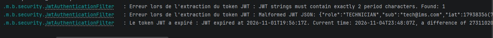

Logs du serveur Spring Boot : le `JwtAuthenticationFilter` bloque les requêtes avec un token mal formé (nombre de points incorrect), un JSON de token malformé et un token expiré.

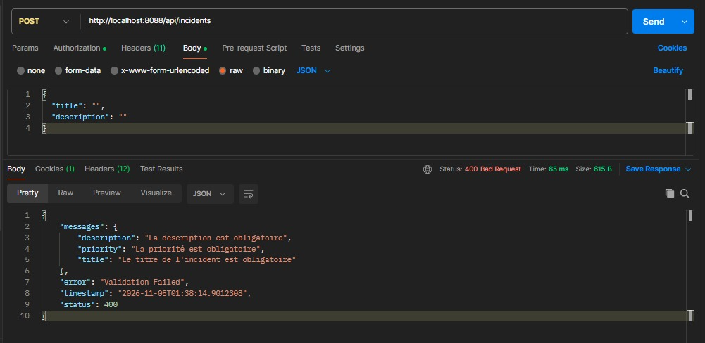

Rejet par le serveur d'une tentative de création d'incident avec des champs vides. Le validateur Spring renvoie une erreur `400 Bad Request` avec le détail des champs manquants.

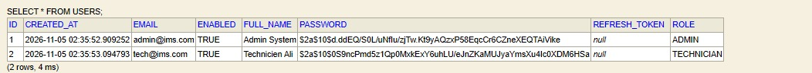

Capture de la base de données  montrant la table `USERS`. On y voit clairement que les mots de passe ne sont pas stockés en clair, mais hachés avec l'algorithme BCrypt (commençant par `$2a$`).

### Interface de l'application

#### Authentification

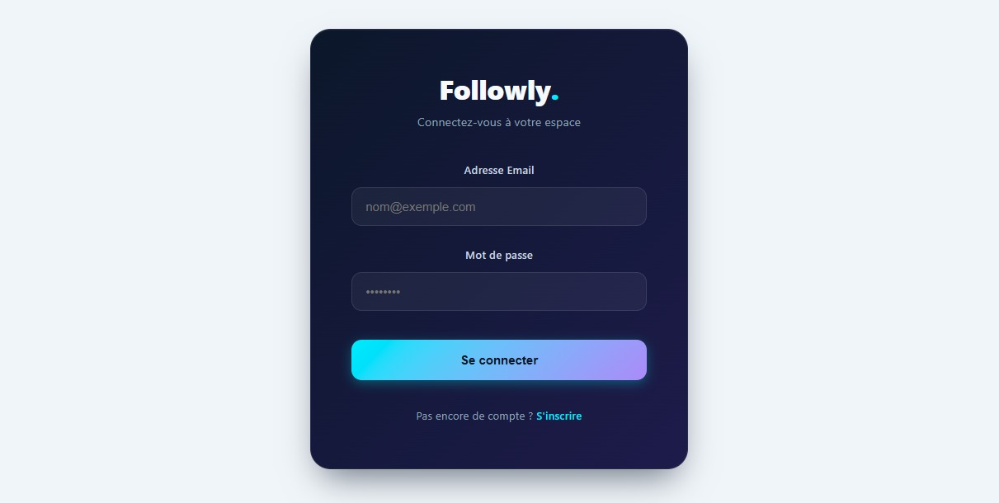

Écran de connexion. L'utilisateur saisit son email et son mot de passe. C'est ici que le frontend récupère le JWT initial.

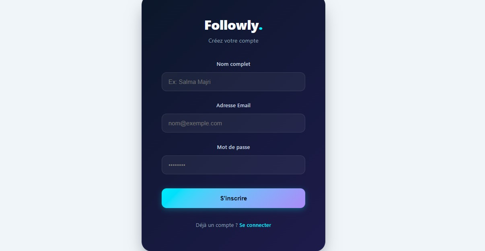

Formulaire d'inscription. Le rôle assigné par défaut est automatiquement `EMPLOYEE`, ce qui empêche toute élévation de privilèges non autorisée.

#### Espace Employé

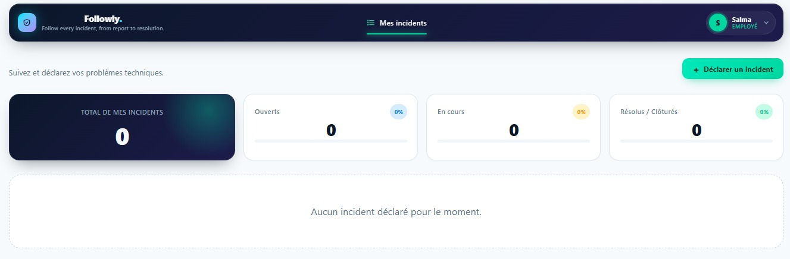

Tableau de bord vide d'un nouvel employé (Salma). Les statistiques sont à 0 et aucun incident n'est listé car le backend filtre les données par propriétaire.

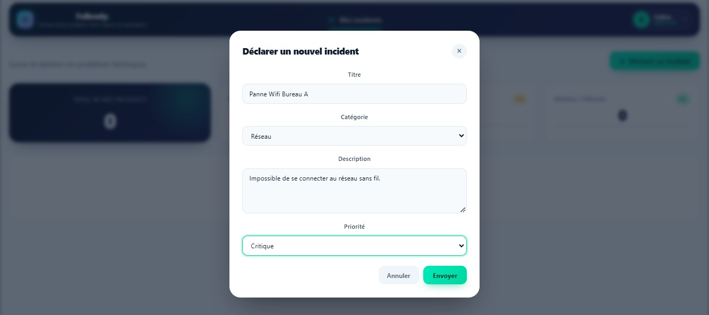

Modale de déclaration d'un nouvel incident. L'employé sélectionne une catégorie et une priorité. Les contraintes de validation (titre et description obligatoires) s'appliquent ici.

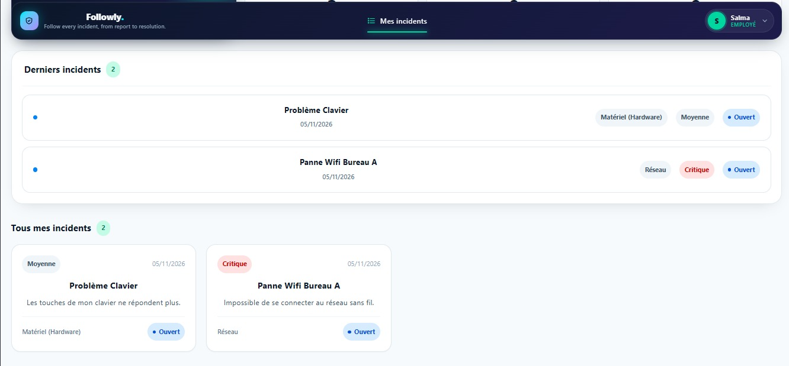

Liste des incidents de Salma. Elle voit ses deux incidents créés avec leurs statuts respectifs.

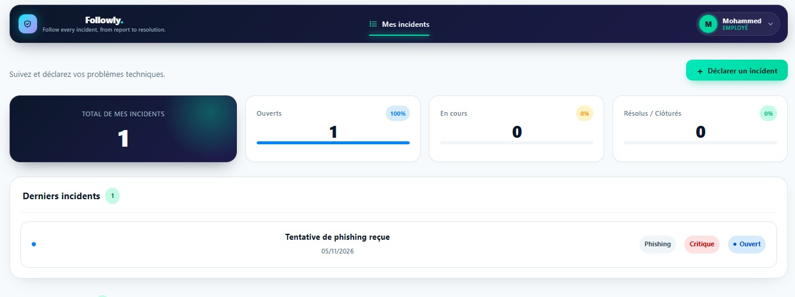

Démonstration de l'isolation des données. L'employé Mohammed est connecté sur un autre navigateur et ne voit que son propre incident, ce qui confirme que les données sont cloisonnées.

#### Espace Administrateur

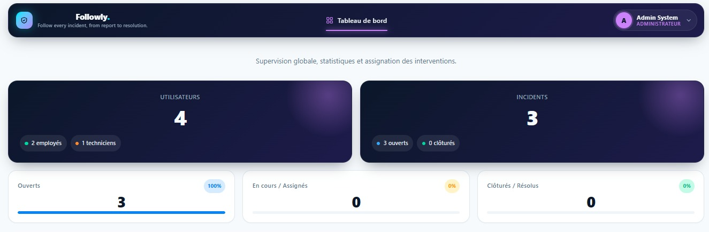

Tableau de bord global de l'administrateur. Il affiche le nombre total d'utilisateurs et la répartition des incidents (ouverts, en cours, clôturés).


Vue de gestion des incidents. L'administrateur peut voir tous les incidents et utiliser le menu déroulant pour affecter un incident spécifique à un technicien.

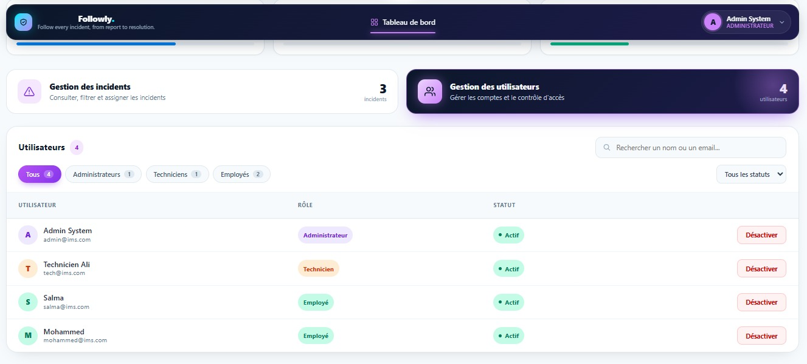

Vue de gestion des utilisateurs. L'administrateur peut activer ou désactiver un compte (désactiver un compte bloque immédiatement sa connexion).

#### Espace Technicien

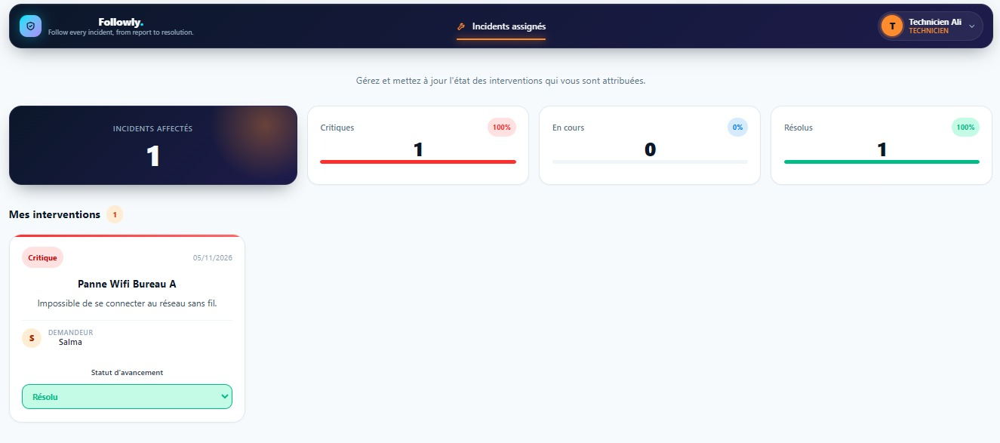

Tableau de bord du technicien (Ali). Il ne voit strictement que les incidents qui lui ont été assignés par l'administrateur.

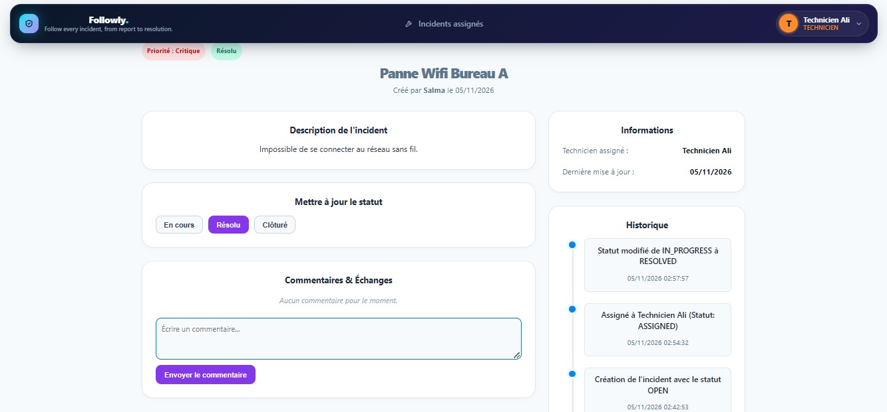

Page de détails d'un incident vue par le technicien. Il peut modifier le statut de l'incident (passer de « En cours » à « Résolu »).

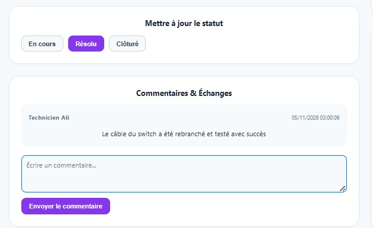

Ajout d'une note de traitement par le technicien. Ces commentaires sont enregistrés et deviennent immuables pour tracer les actions effectuées.

#### Suivi et Profil

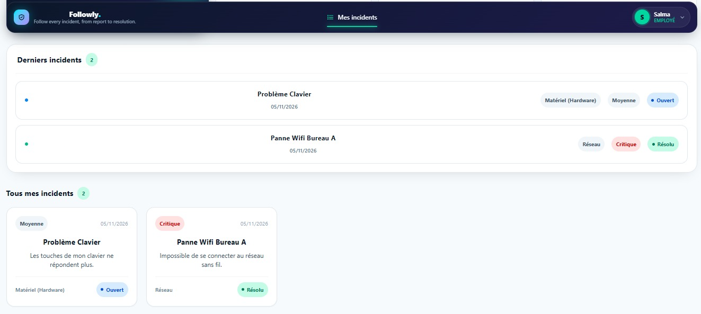

L'employé constate que le statut de son incident a bien été mis à jour par le technicien (passage à « Résolu »).


Vue détaillée de l'incident par l'employé. Il peut consulter tout l'historique (date de création, assignation, changements de statut) et lire le commentaire final du technicien.

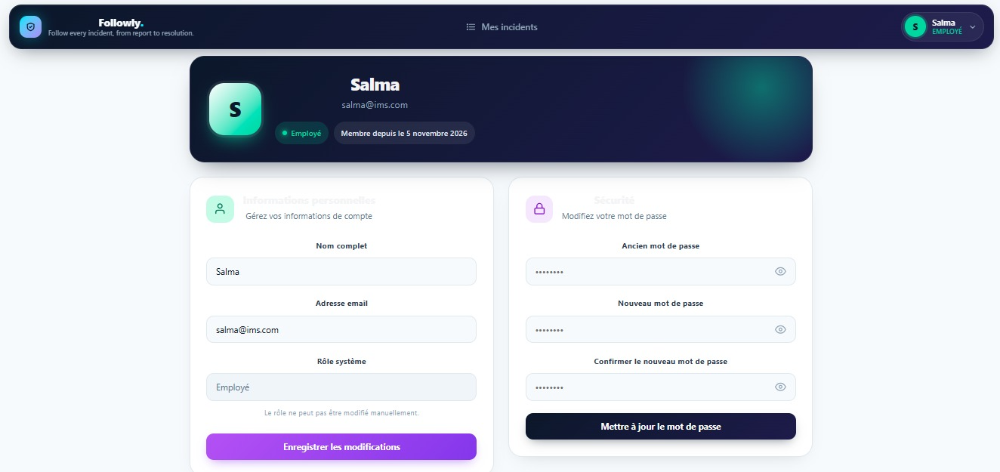

Page de gestion du profil. L'utilisateur peut modifier ses informations personnelles et changer son mot de passe en saisissant son ancien mot de passe pour des raisons de sécurité.